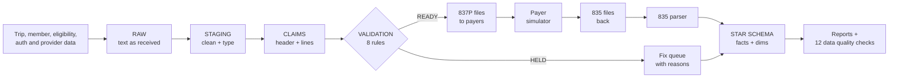
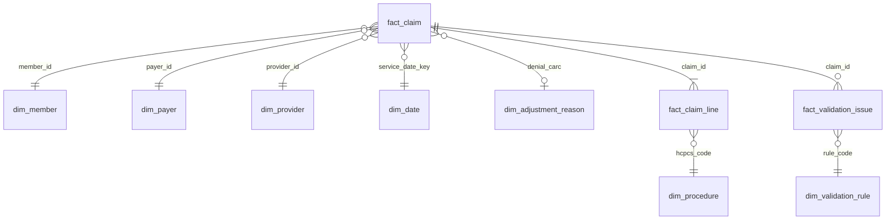

# NEMT Claims Pipeline

An end-to-end healthcare claims data pipeline for **non-emergency medical transportation (NEMT)**, the rides that take Medicaid and Medicare members to dialysis, doctor visits and hospital appointments.

It takes raw ride data and does five things:

1. **Builds** insurance claims from completed rides
2. **Checks** every claim against 8 billing rules *before* it is sent
3. **Writes** the claims as X12 **837P** files (the standard electronic claim format)
4. **Reads back** the payers' X12 **835** payment files and reconciles every dollar
5. **Models** everything into a **star schema** for reporting on denials, payments and payer performance

**Result:** checking claims before sending them dropped the simulated payer denial rate from **14.8% to 1.7%**, preventing **$372K** in denied charges on 28,461 claims.


> All data is synthetic, generated by `nemt_claims/generate_data.py`. No real patients, plans or providers are used. Payer responses come from a built-in payer simulator.

---

## How it works



| Step | What happens | Where |
|---|---|---|
| 1. Generate | Creates 30,558 trips, 2,500 members, 4 health plans, 40 transport providers, eligibility and prior authorizations, with real-world problems planted on purpose | `nemt_claims/generate_data.py` |
| 2. Load raw | Loads every CSV as plain text, like files landing in an S3 bucket | `run_pipeline.py` |
| 3. Staging | Fixes types and messy values (`COMPLETED` vs `completed`, `N186` vs `N18.6`, blanks to NULL) | `sql/01_staging/` |
| 4. Build claims | One claim per completed trip, two lines per claim: base trip code + mileage code, with origin/destination modifier (e.g. `RJ` = home to dialysis) and pricing from each plan's fee schedule | `sql/02_claims/` |
| 5. Validate | Runs 8 rules (below). Claims that fail any rule are **HELD** with the reasons attached | `sql/03_validation/` + `validators.py` |
| 6. Export 837P | Writes READY claims as X12 837P files, one per payer | `nemt_claims/edi_837.py` |
| 7. Payer simulator | Acts as the health plans: checks claims against its own records, pays or denies with real CARC reason codes, writes 835 files | `nemt_claims/payer_simulator.py` |
| 8. Load 835 | Parses the 835 files into claim, line and adjustment tables | `nemt_claims/edi_835.py` |
| 9. Star schema | Builds dimension and fact tables for reporting | `sql/04_marts/` |
| 10. Reports | KPI, hold reasons, denials, payer scorecard, monthly trend | `sql/05_reports/` |
| 11. Quality checks | 12 checks must pass or the run fails (e.g. every 835 claim balances: charge = paid + adjustments) | `nemt_claims/quality_checks.py` |

## The 8 validation rules

| Rule | What it catches | Denial it prevents | Claims caught |
|---|---|---|---|
| `ELIGIBILITY` | Member wasn't covered on the ride date | CARC 27 | 1,091 |
| `INVALID_NPI` | Provider ID fails the NPI check-digit test (Python function called from SQL) | CARC 16 | 716 |
| `PRIOR_AUTH` | Plan requires an authorization and none covers the ride | CARC 197 | 667 |
| `MILEAGE_VARIANCE` | Billed miles differ from GPS miles by more than 25% | Audit / recoupment risk | 603 |
| `DUPLICATE` | Same member, date, time and route already billed | CARC 18 | 559 |
| `MISSING_DX` | No diagnosis code | CARC 16 | 531 |
| `LOS_MISMATCH` | Vehicle sent doesn't match the level of service billed (e.g. billed wheelchair van, sent a sedan) | Audit / compliance risk | 524 |
| `TIMELY_FILING` | Claim would reach the plan after its filing deadline (90 to 365 days) | CARC 29 | 478 |

Two of the rules don't prevent a denial. The payer would pay those claims, but billing them is a compliance risk that can lead to money being taken back in an audit. A good claims pipeline catches both kinds of problem.


## The data model (star schema)



| Table | Grain (one row per…) | Key measures |
|---|---|---|
| `fact_claim` | claim | charge, expected allowed, paid, patient responsibility, contractual adjustment, denied amount, status (HELD / PAID / DENIED) |
| `fact_claim_line` | service line | units, charge, allowed, paid, adjustments |
| `fact_validation_issue` | claim × failed rule | charge at risk |
| `dim_member` | member | age band, county, mobility level (names and birth dates are kept out of the mart: minimum necessary PHI) |
| `dim_payer`, `dim_provider`, `dim_procedure`, `dim_date`, `dim_adjustment_reason`, `dim_validation_rule` | lookup | descriptive fields |

## Results from the latest run

| Measure | Value |
|---|---|
| Trips received | 30,558 |
| Claims built (completed trips only; cancelled and no-show trips are never billed) | 28,461 |
| Clean claim rate | 83.0% |
| Denial rate after validation | 1.7% (down from 14.8%) |
| Net collection rate | 98.2% |
| Data quality checks | 12 / 12 passed |

Full report: [`reports/claims_report.md`](reports/claims_report.md). Sample files: [837P](samples/sample_837P.x12), [835](samples/sample_835.x12), [trips](samples/sample_trips.csv).

## Run it yourself

Requires Python 3.10+. Takes about 10 seconds.

```bash
git clone https://github.com/nandini260856/nemt-claims-pipeline.git
cd nemt-claims-pipeline
pip install -r requirements.txt
python -m nemt_claims.run_pipeline     # runs every step
python -m pytest -q                    # 14 tests
```

Then explore the warehouse with SQL:

```bash
python -c "import duckdb; print(duckdb.connect('data/warehouse.duckdb').sql('SELECT * FROM reports.payer_scorecard'))"
```

## How this maps to AWS

The project runs locally with DuckDB so anyone can run it for free. Each piece maps directly to an AWS service:

| Here | On AWS |
|---|---|
| `data/raw/` CSV files | S3 raw zone (landed by AWS DMS or SFTP) |
| `raw` / `staging` schemas | S3 + AWS Glue jobs, queried with Athena |
| `marts` schema in DuckDB | Amazon Redshift ([DDL with dist/sort keys](infra/redshift_ddl.sql)) |
| `dags/nemt_claims_dag.py` | Amazon MWAA (managed Airflow) |
| 837P / 835 files | S3 outbound/inbound folders exchanged with a clearinghouse |
| `quality_checks.py` | Glue Data Quality or a dbt test step, with failure alerts |

## Project layout

```
nemt_claims/        Python: data generator, pipeline runner, EDI writer/parser, payer simulator, checks
sql/                SQL models, run in folder order: staging -> claims -> validation -> marts -> reports
dags/               Airflow DAG (weekday 6 AM run, 2 retries)
infra/              Redshift table definitions
tests/              14 pytest tests (unit + full pipeline)
docs/               Plain-English guide to claims and to this project
reports/            Latest run report and charts
samples/            Sample 837P, 835 and trip files
```

## Learn more

- [`docs/claims_101.md`](docs/claims_101.md): how healthcare claims work, in plain English
- [`docs/design_decisions.md`](docs/design_decisions.md): why the pipeline is built the way it is

## Limits

The 837P and 835 files follow the X12 5010 structure but are simplified. They have not been certified against any payer's companion guide. The payer simulator uses its own copy of eligibility and authorization data, so it is independent of the validation step. Its ~1.5% "non-covered" denials are random on purpose, to show that validation can't prevent every denial.
