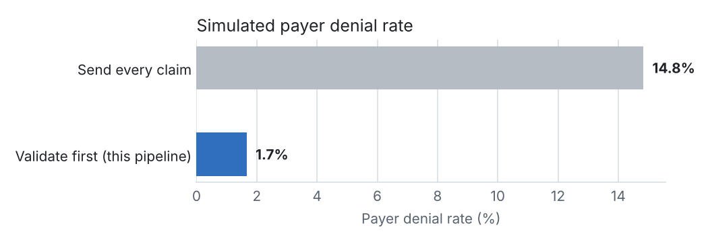
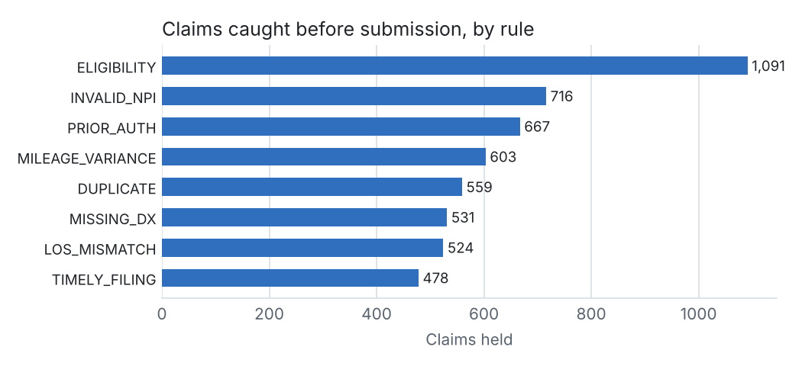

# Claims run report (2026-10-01)

_All data is synthetic. Payer results come from a simulator, not a real health plan._

## Headline

| Measure | Value |
|---|---|
| Trips received | 30,558 |
| Claims built (completed trips) | 28,461 |
| Clean claim rate (passed every check) | 83.0% |
| Claims held for fixing | 4,850 |
| Claims paid / denied | 23,220 / 391 |
| Denial rate on submitted claims | 1.7% |
| Total paid | $1,605,623.26 |
| Net collection rate (paid + patient share vs expected) | 98.2% |

## Validation impact

| Scenario | Claims sent | Denied | Denial rate | Charges denied |
|---|---|---|---|---|
| Send every claim | 28,461 | 4,221 | 14.8% | $411,949.69 |
| Validate first | 23,611 | 391 | 1.7% | $39,382.85 |

## Why claims were held

| Rule | What it means | Risk | Claims | Charges at risk ($) |
|---|---|---|---|---|
| ELIGIBILITY | Member was not covered by the plan on the date of service | denial | 1,091 | 96,159.78 |
| INVALID_NPI | Billing provider NPI fails the check-digit test | denial | 716 | 66,789.26 |
| PRIOR_AUTH | Plan requires a prior authorization and none covers this trip | denial | 667 | 82,111.57 |
| MILEAGE_VARIANCE | Billed miles differ from GPS miles by more than 25% and 2 miles | audit_risk | 603 | 59,658.01 |
| DUPLICATE | Same member, date, pickup time and route already billed | denial | 559 | 52,638.89 |
| MISSING_DX | No diagnosis code on the claim | denial | 531 | 51,920.00 |
| LOS_MISMATCH | Vehicle sent does not match the level of service ordered and billed | audit_risk | 524 | 50,336.56 |
| TIMELY_FILING | Claim would reach the payer after its filing deadline | denial | 478 | 45,400.32 |

## Denials that still happened

| CARC | Reason | Claims | Denied ($) |
|---|---|---|---|
| 96 | Non-covered charge(s) | 391 | 39,382.85 |

## Payer scorecard

| Payer | Claims | Clean claim rate | Denial rate | Paid ($) |
|---|---|---|---|---|
| State Medicaid Fee-for-Service | 9,697 | 85.7% | 1.6% | 549,233.30 |
| Sunrise Health Plan (Medicaid MCO) | 8,646 | 81.1% | 1.7% | 506,078.48 |
| Lakeside Community Care (Medicaid MCO) | 5,994 | 81.4% | 1.7% | 342,452.68 |
| Harbor Medicare Advantage | 4,124 | 82.7% | 1.5% | 207,858.80 |
